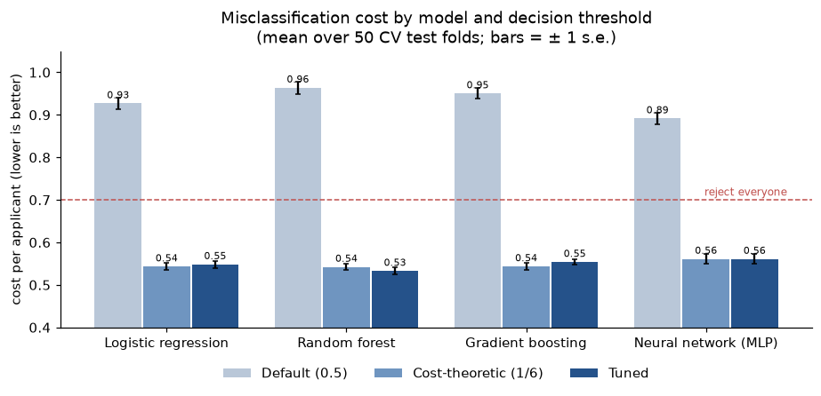
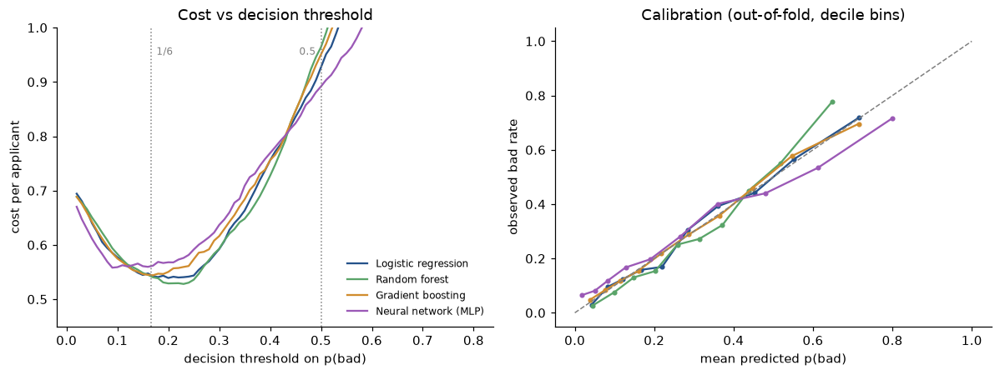
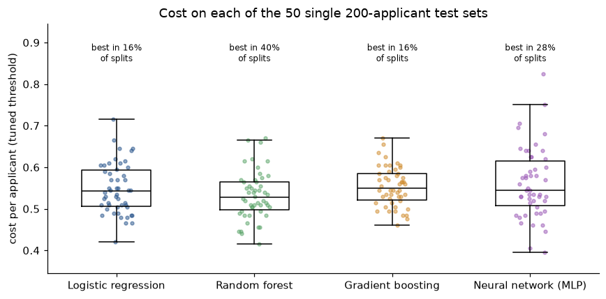

# Credit Scoring: Does the Model or the Decision Threshold Matter More?

When a lender approves an applicant who later defaults, the loss is much larger than when it turns away a good customer. The German Credit dataset comes with an explicit cost matrix: a **missed bad risk costs 5** and a **rejected good customer costs 1**. This project compares four model families and three decision rules under that cost matrix. It uses nested, repeated cross-validation, so the comparisons are reliable rather than based on a single lucky split.

**Tools:** Python · scikit-learn · pandas · NumPy · Matplotlib · Jupyter

📓 **[Open the notebook](notebooks/credit_cost_thresholds.ipynb)**

---

## Results (cost per applicant, mean ± sd over 50 CV test folds; lower is better)

| Model | Default threshold (0.5) | Cost-theoretic (1/6) | Tuned threshold | ROC-AUC |
|---|---|---|---|---|
| Logistic regression | 0.927 ± 0.092 | 0.543 ± 0.063 | 0.549 ± 0.060 | 0.789 |
| Random forest | 0.964 ± 0.102 | 0.542 ± 0.050 | **0.533 ± 0.058** | 0.795 |
| Gradient boosting | 0.951 ± 0.092 | 0.544 ± 0.058 | 0.554 ± 0.047 | 0.783 |
| Neural network (MLP) | 0.892 ± 0.093 | 0.561 ± 0.081 | 0.561 ± 0.085 | 0.783 |
| *Reject everyone* | | *0.700* | | |
| *Approve everyone* | | *1.500* | | |



## Key findings

1. **At the default 0.5 cut-off, every model is worse than rejecting everyone.** The models cost 0.89–0.96 per applicant against 0.70 for the trivial rule, because they catch only 39–47% of bad risks.
2. **The threshold matters ten times more than the model.** A cost-based threshold cuts the cost by about 40% (0.33–0.43 per applicant) for every model, and it did so in all 50 test folds. Once thresholds are set correctly, the four models are within 0.028 of each other.
3. **The theoretical 1/6 cut-off is as good as tuning.** Hyperparameters are chosen by log-loss, which keeps the probabilities calibrated, so the decision-theory threshold needs no extra data. It came within 0.01 of the tuned threshold, or beat it.
4. **One 200-applicant test set cannot rank models.** A model's cost varies by 0.21–0.43 across test folds. The overall best model, the random forest, wins on only 40% of individual splits.
5. **Logistic regression is the sensible choice.** It is within 0.016 of the best model, gives calibrated probabilities, and is the easiest model to explain to an applicant.

| Cost vs threshold, and calibration | Cost on each single 200-applicant split |
|---|---|
|  |  |

**What drives the risk score.** The strongest factors are a negative checking balance, a new-car purpose, low savings, longer loan duration and a high instalment rate. A *critical account* history appears to *lower* risk. This is a known selection effect: the data contains only loans that were approved. The notebook also flags that sensitive attributes (sex and marital status, age, foreign-worker status) are model inputs, which a real deployment would have to remove and audit for proxies.

## Method

- **Data:** 1,000 applicants with 20 attributes and 30% bad risks, from the [Statlog German Credit dataset (UCI)](https://archive.ics.uci.edu/dataset/144/statlog+german+credit+data). The coded values (e.g. `A11`) are mapped to readable labels.
- **Models:** logistic regression, random forest, histogram gradient boosting and an MLP. They use one-hot encoding, with numeric features standardised for the linear model and the MLP.
- **Protocol:** 10 × repeated stratified 5-fold CV gives 50 outer test folds. Inside each training fold:
  - hyperparameters are tuned by inner 5-fold CV on log-loss;
  - the decision threshold is tuned on inner out-of-fold predictions.
  
  No choice ever sees the test fold.
- **Decision rules:** default 0.5, the Bayes-optimal cut-off p(bad) > 1/6 implied by the 5:1 cost matrix, and the tuned threshold.
- **Metrics:** average cost per applicant (primary), share of bad risks caught, rejection rate, ROC-AUC, calibration curves, and paired fold-by-fold comparisons.

## Limitations

- The 5:1 cost matrix is the one published with the dataset. Real costs depend on loan size, recovery rates and customer profit, and would shift the optimal threshold.
- The data covers approved loans from one bank in the 1990s, so it has reject-inference bias and its age shows.
- Repeated-CV folds overlap, so fold-level standard deviations understate the uncertainty of the means.

## Repository structure

```
credit-cost-thresholds/
├── notebooks/credit_cost_thresholds.ipynb   # full analysis with outputs
├── figures/                                 # charts exported from the notebook
├── requirements.txt
└── README.md
```

## Reproducing

No data files are needed. The notebook downloads the dataset directly from the UCI repository.

```bash
pip install -r requirements.txt
jupyter notebook notebooks/credit_cost_thresholds.ipynb
```

The full nested cross-validation takes about 5 minutes on a laptop.

## References

- Hofmann, H. (1994). *Statlog (German Credit Data)*. UCI Machine Learning Repository.
- Elkan, C. (2001). *The Foundations of Cost-Sensitive Learning.* IJCAI 2001.
- Niculescu-Mizil, A. & Caruana, R. (2005). *Predicting Good Probabilities with Supervised Learning.* ICML 2005.
- Baesens, B. et al. (2003). *Benchmarking state-of-the-art classification algorithms for credit scoring.* Journal of the Operational Research Society, 54(6).
